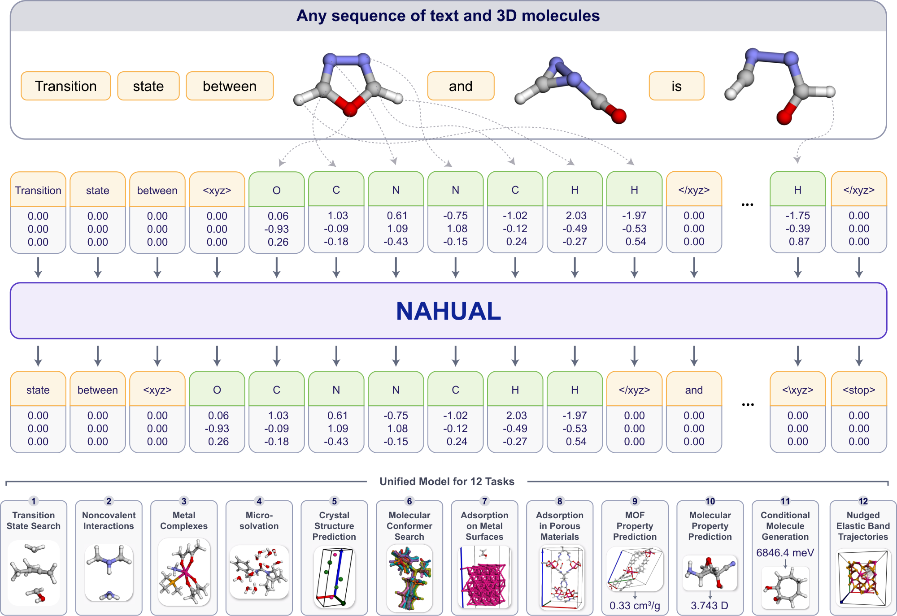
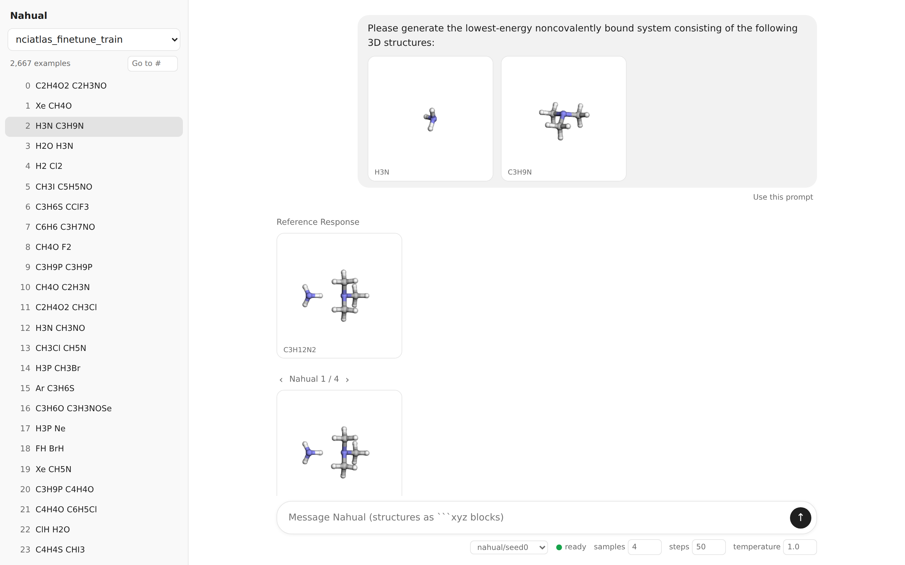

# Nahual: A Sequence Model for Language and Atoms

[Paper](https://arxiv.org/abs/2611.19072) | [Checkpoints, data and evaluation samples](https://huggingface.co/the-matter-lab/nahual) | [Results](https://huggingface.co/the-matter-lab/nahual#results)

Nahual is a decoder-only autoregressive diffusion model for any sequence of text and 3D
molecules. Instead of calling tools to handle 3D structures, Nahual predicts the next
word or diffuses the next atom's 3D position. Nahual uses next-token diffusion, whereby a
causal transformer denoises each token while attending to the clean tokens before it,
without increasing context size.

Nahual is initialized from Qwen3-0.6B and trained end-to-end on the twelve 3D chemistry
tasks below, from transition-state search and microsolvation to conformer search and
adsorption on metal surfaces. A single set of 1.6B-parameter weights performs all tasks
and beats state-of-the-art specialist models on crystal structure prediction (MP-20) and
property-conditional molecule generation (QM9).



This repository has the code to train, sample, evaluate and browse Nahual. Paper:
[*Nahual: A Sequence Model for Language and Atoms*](https://arxiv.org/abs/2611.19072) (NeurIPS 2026).

## Tasks

| Task | Prompt | Response | Data |
|---|---|---|---|
| Transition states | reactant and product | transition state | Transition1x, RGD1-xTB |
| Noncovalent interactions | two molecules | lowest-energy dimer | NCI Atlas |
| Metal complexes | metal, ligands, charge, multiplicity, oxidation state | complex | LnQM |
| Microsolvation | solute and number of waters (1 to 10) | solvated solute | QCG-10 (new) |
| Crystal structures | chemical formula | unit cell | MP-20 |
| Conformers | SMILES | up to 10 diverse conformers | GEOM-DRUGS |
| Adsorption on surfaces | adsorbate and surface | adsorbed configuration | Alloy, FG, OCD |
| Adsorption in MOFs | MOF and adsorbate names | MOF with the adsorbates placed | ODAC25 |
| MOF properties | MOF | pore volume, surface area or band gap | CoRE MOF, QMOF |
| Molecular properties | molecule | one of six QM9 properties | QM9 |
| Conditional molecules | target property value | molecule | QM9 |
| NEB paths | initial and final states | 10-frame minimum energy path | OC20NEB |

Structures go in and come out as 3D coordinates; formulas, SMILES and property values
are text. The crystal structure prompt, for example, is *Generate an inorganic crystal
unit cell with chemical formula Ga4 Te4*. The [model card](https://huggingface.co/the-matter-lab/nahual)
has the results on every test set.

## How it works

Each token pairs a discrete part, a word piece or an atomic number, with a 3D position,
which is zero for words. A transformer initialized from Qwen3-0.6B predicts the next
discrete token, as a language model does. For an atom, a second causal transformer then
generates its position by diffusion, conditioned on the clean sequence so far. The paper
calls this next-token diffusion. DiffMLP, the paper's ablation, replaces the second
transformer with a per-token diffusion MLP and is otherwise trained the same way.

## Checkpoints and data

All of these are on the Hub at [`the-matter-lab/nahual`](https://huggingface.co/the-matter-lab/nahual).
Checkpoints were trained for 115,000 steps.

| Path | Contents |
|---|---|
| `checkpoints/nahual/seed{0,1}/` | Nahual, two seeds |
| `checkpoints/diffmlp/seed{0,1}/` | DiffMLP, two seeds |
| `data/` | training, validation and test splits of every task |
| `samples/{nahual,diffmlp}/seed{0,1}/` | evaluation samples and metrics for every task |
| `assets/qm9/`, `assets/egnn_oracles/` | QM9 files and the EGNN property oracles of Bao et al. (2023) |

## Install

Python 3.11+ and PyTorch 2.10+ are required. Install the PyTorch build that matches
your CUDA version first (see pytorch.org), then the package:

```bash
git clone https://github.com/the-matter-lab/nahual.git && cd nahual
python -m venv .venv && source .venv/bin/activate
pip install -e .              # optional extra: '.[logging]' (W&B)
cp .env.example .env          # optional: change where data, weights and outputs live
set -a; source .env; set +a   # load it before the commands below
python scripts/download_assets.py
```

`download_assets.py` fetches the pinned Qwen3-0.6B weights and tokenizer. Large
data, weights, checkpoints and results are kept out of Git.

Attention uses `torch.nn.attention.varlen` (PyTorch 2.13+). On older PyTorch the
model falls back to FlexAttention with one warning; pass `--attention_backend=flex`
to silence it.

## Quick start: the viewer



`scripts/viewer/` is a small browser viewer in the style of a chat app. It can:

- **Browse the data.** Pick any training, validation or test split and see each prompt
  with its reference response.
- **Browse evaluation samples.** Pick an evaluation task to see Nahual's samples next to
  the reference, each with its metric, such as RMSD to the reference, crystal match, or
  absolute error. This works with the Hub's `samples/` folder or your own results.
- **Prompt a checkpoint.** "Use this prompt" copies an example's prompt into the message
  box. Edit it, or type your own; structures are written as ```` ```xyz ```` blocks. Sending
  it generates several responses from the checkpoint chosen below the box.

Conversations are single turn: each message is answered on its own, without history.
Browsing runs on a CPU; generation needs a GPU.

```bash
hf download the-matter-lab/nahual --include "samples/nahual/seed0/*" "checkpoints/nahual/seed0/*" --local-dir hub
python scripts/viewer/server.py --samples hub/samples
```

Open http://localhost:8000. The checkpoint list holds the checkpoints next to `hub/samples`
and your runs in `logs/`, plus a custom path. Nahual seed 0 loads in the background at
startup. Without `--samples`, the viewer lists your own results in `evals/results`. On a
remote GPU machine, forward the port first: `ssh -L 8000:localhost:8000 <machine>`.

Without the viewer, `nahual.infer` samples responses to a prompt (see [Inference](#inference)).

## Data

```bash
python -m nahual.prepare download        # data from the-matter-lab/nahual, SHA256-checked
bash scripts/prepare_data.sh             # tokenize, filter and audit the training mixture
```

`download` writes to `NAHUAL_RAW_DIR` (`data/raw` in `.env.example`).
`prepare_data.sh` converts text/XYZ segments into memory-mapped tokens,
coordinates, sequence lengths and prompt boundaries under `NAHUAL_PROCESSED_DIR`,
then writes `audit.json`, which training requires. Use a machine with several
cores; set `NAHUAL_PREPARE_WORKERS` to change the default of 8 processes.

`configs/datamix.json` specifies the weighted training mixture. Training requires
a matching `audit.json` and rejects changed data or mixtures. Sequences longer than
4,096 tokens are excluded. Packed document boundaries and prompt tokens are
excluded from the loss.

## Training

### From scratch

| Config | Model |
|---|---|
| `configs/next_token_seed0.json`, `configs/next_token_seed1.json` | Nahual |
| `configs/diffmlp_seed0.json`, `configs/diffmlp_seed1.json` | DiffMLP |

These are the configurations of the released runs: AdamW at LR `4e-4`, 5,000 warmup
steps, constant to step 110,000, then 5,000 linear-decay steps (115,000 in total);
response-only loss; FP32 EMA with decay 0.999. Each step packs 24,480 tokens per GPU
on 32 GPUs (783,360 tokens per step, 90.1B tokens in total).

```bash
torchrun --nproc_per_node=4 train.py --config=configs/next_token_seed0.json --grad_accum_steps=8
```

The global batch is GPUs × `grad_accum_steps` × `chunk_size` tokens, so 4 GPUs with
`--grad_accum_steps=8` match 32 GPUs. A 24,480-token chunk uses about 150 GB per
GPU. On smaller GPUs, lower `--chunk_size` and raise `--grad_accum_steps` to keep the
product near 783,360. For several machines, use the usual
`torchrun --nnodes/--node_rank/--master_addr` flags.

Command-line flags override JSON values. Checkpoints in
`logs/nahual/<name>/checkpoints/` hold the model, FP32 EMA, optimizer, scheduler,
step, token count and configuration; `last.pt` updates atomically, and rerunning
the same command resumes from the newest one. Weights & Biases logging is off by
default (`--wandb=true --entity=<your-entity>`, needs `.[logging]`).

### From a released checkpoint

```bash
hf download the-matter-lab/nahual --include "checkpoints/nahual/seed0/*" --local-dir hub
torchrun --nproc_per_node=4 train.py --config=configs/next_token_seed0.json --grad_accum_steps=8 \
  --name=nahual_continued --resume_path=hub/checkpoints/nahual/seed0/step_115000.pt --max_steps=130000
```

`--resume_path` restores the weights, EMA, optimizer, scheduler and step, and
training continues to `--max_steps` under the schedule of the current flags (here a
constant LR to step 125,000, then the decay). Once the run has its own checkpoints,
rerunning the command resumes from the newest of them instead.

To continue on a different mixture, write a JSON like `configs/datamix.json` with
the splits and weights you want (`python -m nahual.prepare list` lists the released
splits), prepare and audit it, and pass it to training. The audit records one
mixture at a time, so rerun it when you switch:

```bash
python -m nahual.prepare preprocess --mixture my_datamix.json
python -m nahual.prepare audit --mixture my_datamix.json
torchrun --nproc_per_node=4 train.py --config=configs/next_token_seed0.json --grad_accum_steps=8 \
  --name=nahual_my_datamix --dataconfig=my_datamix.json \
  --resume_path=hub/checkpoints/nahual/seed0/step_115000.pt --max_steps=130000
```

To start a new run from the released weights instead, with a fresh optimizer and
learning-rate schedule, pass `--state_dict_path=hub/checkpoints/nahual/seed0/step_115000.pt`
in place of `--resume_path`. It loads the EMA weights.

## Inference

A prompt is a JSON list of segments, for example:

```json
[{"type":"text","text":"Generate a molecule with a dipole moment of 1.5 D"}]
```

XYZ segments use `{"type":"xyz","atoms":[6,1],"coords":[[0,0,0],[1,0,0]]}`.
Both architectures use the same command:

```bash
python -m nahual.infer --checkpoint hub/checkpoints/nahual/seed0/step_115000.pt \
  --prompt prompt.json --output samples.json --samples 8 --steps 50
```

`--checkpoint` takes any checkpoint, released or from your own training
(`logs/nahual/<name>/checkpoints/step_N.pt`), and uses its EMA weights unless
`--no-ema` is given.

## Evaluation

Evaluation takes the same `--checkpoint` files: a released checkpoint or any
`step_N.pt` from your own training.

Each benchmark is a folder in `evals/tasks/` with a `task.json` manifest (dataset,
defaults, sample budget) and its scorer. `examples/evaluation/` shows a minimal one;
`--task-dir examples` adds such folders to the catalog.

| Paper family | Evaluation task(s) |
|---|---|
| Transition states | `t1x` |
| Noncovalent dimers | `nci` |
| Metal complexes | `lnqm` |
| Microsolvation | `qcg_1to10` |
| Crystal structure | `csp` |
| Conformer search | `geomconf_diverse` |
| Surface adsorption | `gmae_alloy`, `gmae_fg`, `gmae_ocd` |
| Porous adsorption | `odac` |
| MOF properties | `coremof_pore_volume`, `coremof_surface_area`, `qmof_bandgap` |
| Molecular properties | `qm9_edm_prop_{alpha,gap,homo,lumo,mu,Cv}` |
| Conditional molecules | `qm9_edm_cond_{alpha,gap,homo,lumo,mu,Cv}` |
| NEB paths (type-forcing) | `neb_constrained` |

One task on one GPU:

```bash
python -m evals list
python -m evals run --backend checkpoint --task t1x --checkpoint hub/checkpoints/nahual/seed0/step_115000.pt
python -m evals run --backend checkpoint --task csp --checkpoint hub/checkpoints/nahual/seed0/step_115000.pt \
  --num_examples 32 --prompt_batch_size 16
```

Results go to `evals/results/<task>/<run_name>/` (`predictions.pt`, `metrics.json`).
`--phase generate` and `--phase metrics` split generation from scoring.

Saved samples, your own or the released ones in the Hub's `samples/` folder, can be
scored again without generating. `score` rewrites `metrics.json` in the folder it is
given. Folder names are task names, except that the relaxed microsolvation samples
in `qcg_1to10_xtb_relaxed_crude` are scored as `qcg_1to10`. Self-reward@5 for
conditional QM9 comes from the samples of the six `qm9_edm_cond_*` folders:

```bash
hf download the-matter-lab/nahual --include "samples/nahual/seed0/*" --local-dir hub
python -m evals score --task t1x --run-dir hub/samples/nahual/seed0/t1x
python -m evals score --task qcg_1to10 --run-dir hub/samples/nahual/seed0/qcg_1to10_xtb_relaxed_crude
python -m evals.tasks.conditional_molecules.self_oracle --samples_dir hub/samples/nahual/seed0
```

The full protocol of the paper runs on one machine: every task on its full test set
(microsolvation on the first 500 of its 1,135 prompts), with the paper's sample budgets,
crude xTB relaxation for microsolvation and self-reward@5 selection for conditional QM9.
One worker process runs per GPU, and rerunning the same command skips completed tasks:

```bash
python -m evals run --protocol paper --checkpoint hub/checkpoints/nahual/seed0/step_115000.pt \
  --run-name nahual_seed0_paper --gpus 4
```

`--gpus` defaults to every visible GPU; `--tasks t1x csp` restricts the task set,
and `--num-examples 4` makes a quick smoke test. Per-task logs are in
`evals/results/requests/<run-name>.results/`, and results in
`evals/results/<task>/<run-name>/`. QM9 conditional generation uses the pretrained
EGNN property oracles of Bao et al. (2023) (`python scripts/download_assets.py --qm9-evaluator`).
QCG energy metrics and relaxation need `xtb` on `PATH`. The
small QCG reference energies and GEOM conformer-count tables ship with their
benchmark folders.

Collect every `metrics.json` into one table, and run the unit tests (CPU only):

```bash
python scripts/collect_metrics.py --output metrics.csv
python -m unittest discover -s tests -v
```

See [`docs/reproduction.md`](docs/reproduction.md) for the full training recipe of
the paper runs and how the code was validated.

## Limitations

- The model shows catastrophic forgetting of natural language, and will likely produce
  malformed output for prompt formats outside of the training mixture.
- Generated coordinates are not relaxed. Check them, for example with xTB or DFT, before
  downstream use.
- Sampling is slower than with specialized models, because every atom position takes a
  multi-step diffusion solve.

## Citation

```bibtex
@inproceedings{cheng2026nahual,
  title     = {Nahual: A Sequence Model for Language and Atoms},
  author    = {Cheng, Austin H. and M{\"u}ller, Marcel and Burger, Andreas and Kang, Yeonghun and Ko, Tsz Wai and Skreta, Marta and Mucko, Luka and Rajaonson, Ella Miray and Ser, Cher Tian and Gonthier, J{\'e}r{\^o}me F. and Zook, Alex and Bernales, Varinia and Aspuru-Guzik, Al{\'a}n},
  booktitle = {Advances in Neural Information Processing Systems},
  year      = {2026}
}
```

## License

The code and the released weights are under the Apache 2.0 license (`LICENSE`).
Source files adapted from other projects name their origin at the top of the file, and
`THIRD_PARTY_NOTICES.md` lists them with their licenses.
The data in the Hugging Face repo keeps the licenses of the datasets it comes from.
